# divizu

Deterministic **DSL → SVG** architecture diagrams for coding agents. An agent
reads the repository, writes a small `.di` file, validates it, and gives the user
a layered drawing with sockets, plugs and cables.

- Zero runtime dependencies.
- No DOM, canvas or browser needed.
- Same DSL → byte-identical SVG.
- Shared providers are drawn once; `fresh` opts into a separate instance.
- Strict parser and validator with file-relative `line:column` and fix hints.



Try the [live sample](https://jeysef.github.io/divizu/), open the
[full playground](https://jeysef.github.io/divizu/playground.html), or read the
[documentation](https://jeysef.github.io/divizu/docs.html).

## For agents

Point a coding agent at the [skill](https://jeysef.github.io/divizu/skills/divizu.md)
or the [llms.txt](https://jeysef.github.io/divizu/llms.txt) context file. The
agent can validate the DSL, render an SVG, or hand back a playground link
without installing anything.

```text
Use divizu to diagram this project's architecture. Read
https://jeysef.github.io/divizu/skills/divizu.md and follow it. Write the
architecture as a .di file, validate it, render it to SVG, and show me the result.
```

## Quick start

Requirements:

- Node **18+** to consume the built package or CLI.
- Node **22.18+** to run `src/*.ts` directly (tests, dev CLI).

```bash
npm install
npm run build

node dist/cli.js examples/quickstart.di --check
node dist/cli.js examples/quickstart.di -o quickstart.svg
```

The package is `divizu`. The CLI is available as `divizu` (and `diviz` for
compatibility).

## Why

| Problem with hand-written or AI-generated diagrams | What divizu does |
| --- | --- |
| A shared logger is copied into every consumer | One provider node, one cable per socket |
| Every model invents different roles | Exactly four roles with tests an agent can apply |
| Typos become plausible architecture | Strict validation with suggestions and `line:column` |
| Layout depends on a browser or fonts | Monospace width grid and deterministic geometry |
| A huge repo becomes an unreadable blob | Layered graph, 5–25 blocks per plate, split by context |
| No provenance | `src:` per block plus `--check --verify-src` |

## The DSL

```dsl
root CheckoutApp "cmd/api" {
  src: "cmd/api/main.go:24"
  needs Orders <- OrdersLive
  needs Clock
}

component OrdersLive "order use case" {
  provides: Orders
  src: "internal/orders/live.go:18"
  tag: service
  needs Db <- DbLive
  needs Logger <- LoggerLive
  modules: ValidateCart, PriceOrder
}

boundary DbLive "postgres" {
  provides: Db
  src: "internal/db/pg.go:12"
  tag: closer
  needs Config <- AppConfig
}

value AppConfig "config" {
  provides: Config
  src: "internal/config/config.go:9"
}
```

Grammar:

```dsl
file       = { block } ;
block      = role ident [ string ] "{" { NL | directive } "}" ;
role       = "root" | "component" | "boundary" | "value" ;
directive  =
    "provides"   ":" list
  | "needs"      key [ "<-" [ "fresh" ] ident ]
  | "modules"    ":" list
  | "candidates" ":" candidate { "," candidate }
  | "tag"        ":" list
  | "src"        ":" string
  | "label"      ":" name ;
list       = name { "," [ NL ] name } ;
candidate  = name [ "(" name ")" ] ;
```

Rules:

- Braces are mandatory, even for empty blocks: `component Leaf {}`.
- Directives end at a newline or `;`.
- Comments (`#`, `//`) only start at a token boundary. `C#Parser` is a name.
- Quote names with spaces or punctuation: `provides: "@app/Users"`.
- `provides:` is optional. When present, `needs K <- P` is checked against it.
- Shared providers are drawn once. `needs K <- fresh P` duplicates one instance
  for that consumer.
- Every non-root block must be referenced; every root must be unreferenced.
- Cycles, duplicate ids, duplicate needs and ambiguous providers are errors.
- `modules:` are internal collaborators; `candidates:` are alternatives.
- `tag:` is open vocabulary (`closer`, `scoped`, `singleton`, `factory`).
- `src:` is provenance, not parsed code.

### Roles

| Role | Test the agent applies |
| --- | --- |
| `root` | The program/entry point that constructs and connects everything |
| `component` | Internal code that gets wired in |
| `boundary` | This code crosses a process boundary: DB, network, queue, vendor SDK |
| `value` | Injected data with no behaviour: config, constants, flags |

Language details belong in `tag:`, not in the role. A Postgres adapter built by a
layer is both a boundary and a tagged layer; you do not need a fifth role.

## Validation and the agent loop

```bash
# human-readable diagnostics with snippets
node dist/cli.js architecture.di --check

# machine-readable report
node dist/cli.js architecture.di --check --json

# check that every src: path exists
node dist/cli.js architecture.di --check --verify-src
```

`--check --json` returns:

```json
{
  "ok": false,
  "file": "architecture.di",
  "errors": [
    {
      "code": "unknown-provider",
      "message": "Unknown provider \"DbLve\" for Db on \"OrdersLive\".",
      "line": 12,
      "column": 16,
      "suggestion": "Did you mean \"DbLive\"?"
    }
  ],
  "warnings": []
}
```

Use `--json` without `--check` to print computed layout geometry.

## Layout

The layout is a layered DAG:

1. Roots sit at the bottom.
2. Every provider sits above all consumers that need it.
3. Long edges get routing lanes between layers.
4. Shared providers occupy one node per declared block.
5. Cables are orthogonal and run behind the nodes.

Multiple roots are laid out side by side and share the same upper layers. The
useful limit is reading, not computation: keep a plate around 5–25 blocks and
split large systems by bounded context. The renderer guards at 5,000 instances.

## CLI

```text
divizu <input.di> [options]
cat graph.di | divizu [options]
```

| Option | Description |
| --- | --- |
| `-o, --out <file>` | Write SVG to a file (default: stdout) |
| `-t, --theme <mode>` | `auto`, `dark`, `light` (default `auto`) |
| `-p, --padding <px>` | Canvas padding (default 56) |
| `--radius <px>` | Corner radius (default 8) |
| `--layer-gap <px>` | Space between dependency layers (default 78) |
| `--socket-gap <px>` | Space between sockets and nodes (default 28) |
| `--responsive` | Emit `width="100%" height="100%"` |
| `--title <text>` | Accessible SVG title |
| `--check` | Validate without rendering |
| `--json` | Layout JSON; with `--check`, a validation report |
| `--verify-src` | With `--check`, verify `src:` paths exist |
| `-w, --watch` | Re-render when the input file changes |

## API

```ts
import { render, mount, layout, validate } from "divizu";

const { svg, width, height } = render(dsl, { theme: "dark" });

const report = validate(dsl);
if (!report.ok) console.error(report.errors);

const geometry = layout(dsl);
for (const node of geometry.nodes) {
  console.log(node.label, node.layer, node.x, node.y, node.width);
}
```

Exports: `render`, `mount`, `layout`, `validate`, `parseDocument`, `parseDSL`,
`themeCss`, `THEME_CSS`, `DivizuError`, and the public types.

## Theming

The SVG embeds a self-contained stylesheet and uses low-specificity `:where()`
selectors, so host CSS can override any `--di-*` variable without `!important`.
Colors are also emitted as concrete attributes for rasterizers without CSS
variable support.

```css
.my-diagram .di-viz {
  --di-canvas-bg: #0b1020;
  --di-surface: #131a2b;
  --di-stroke-root: #22d3ee;
  --di-stroke-component: #93c5fd;
  --di-stroke-boundary: #fbbf24;
  --di-stroke-value: #5eead4;
  --di-wire: #64748b;
}
```

`divizu/theme.css` is generated at build time.

## Examples

- [quickstart.di](examples/quickstart.di) / [SVG](examples/quickstart.svg)
- [checkout.di](examples/checkout.di) / [SVG](examples/checkout.svg)
- [shared.di](examples/shared.di) / [SVG](examples/shared.svg)
- [candidates.di](examples/candidates.di) / [SVG](examples/candidates.svg)
- [large.di](examples/large.di) / [SVG](examples/large.svg) — 28 blocks, 3 roots

## Development

```bash
npm run build       # compile + generate theme.css
npm run typecheck
npm test
npm run site:build  # build dist + copy examples into site/
npm run site:serve   # serve site/ at http://localhost:8000
```

Source layout:

```text
src/ast.ts          public AST and layout types
src/parser.ts       lexer + strict parser
src/validate.ts     semantic checks and diagnostics
src/layout.ts       layered DAG layout and cable routing
src/render.ts       SVG compiler
src/theme.ts        palette + embedded CSS
src/cli.ts          CLI, --check, --json, --verify-src
test/               parser, validation, layout and rendering
examples/           working sources + generated SVGs
site/               live sample, playground, docs and agent skill
```

## Limits

- Shared providers use one node; `fresh` duplicates the immediate provider.
- Graphs must be acyclic. Cut callback/event loops with an unbound need.
- Text width is a monospace heuristic; CJK or emoji-heavy labels can overflow.
- Dependency sockets are on the top edge. Candidate side notches are the only
  side sockets.
- `--verify-src` checks that paths exist, not that the code matches the claim.
- The model describes wiring and ownership. It is a poor fit for dataflow, actor
  topologies, UI trees and ECS world state.

## License

MIT.
